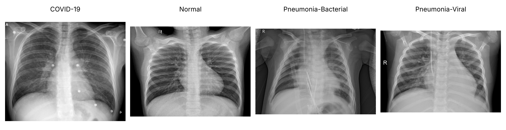
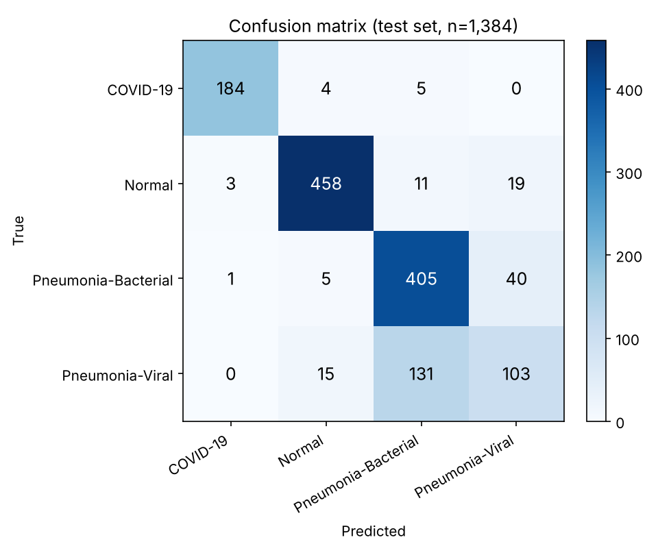
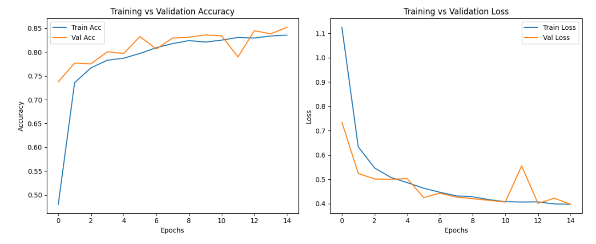
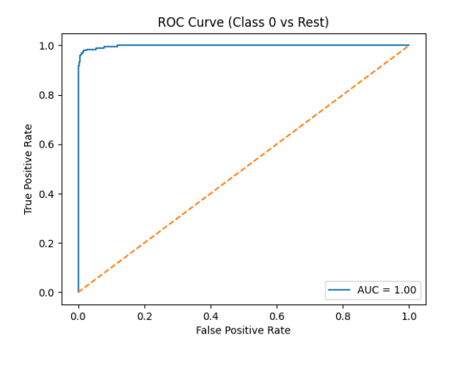

# CNN-based Pneumonia / COVID-19 Classification from Chest X-rays

Course project (UBM2722 – Neural Networks and Pattern Recognition, SSN College of Engineering, September 2025), done as a team of three. The task is an **ablation study** of the lightweight sequential CNN from Hariri & Avşar (2023), classifying chest X-rays into four classes: **COVID-19, Normal, Bacterial pneumonia, Viral pneumonia**.

## Dataset

[3 Kinds of Pneumonia (Kaggle)](https://www.kaggle.com/datasets/artyomkolas/3-kinds-of-pneumonia): 9,208 chest X-rays pooled from 15 public datasets (Normal 3,270 · COVID-19 1,281 · Bacterial 3,001 · Viral 1,656). The dataset is not included in this repository (only a few example X-rays and the result figures are in `images/`). Split: 70 % train / 15 % validation / 15 % test.

## Example images



*One sample chest X-ray per class from the Kaggle dataset above (left to right: COVID-19, normal, bacterial pneumonia, viral pneumonia). Image size, framing and acquisition vary a lot between sources.*

## Model (`model.py`)

Six 3×3 convolution blocks (32 → 64 → 96 → 125 → 150 → 150 filters, ReLU + 2×2 max-pooling) → **global average pooling** → Dense(128) + dropout 0.5 → Dense(4).

Changes relative to the reference architecture (the ablation):
1. Removed one dense layer (256 → 128 → 64 → output became 128 → output).
2. Added a sixth convolutional block.
3. Replaced Flatten with global average pooling.

## Training setup

Adam, learning rate 0.001, batch size 16, 15 epochs, images resized to 150×150, augmentation: resize, normalise, horizontal flip, rotation. Cross-entropy loss.

## Results

Test set: 1,384 images. **Test accuracy: 83.1 %** (validation accuracy at the last epoch: about 85.2 %).

| Class | Precision | Recall | F1 | Test images |
|---|---|---|---|---|
| COVID-19 | 0.979 | 0.953 | 0.966 | 193 |
| Normal | 0.950 | 0.933 | 0.941 | 491 |
| Bacterial pneumonia | 0.734 | 0.898 | 0.808 | 451 |
| Viral pneumonia | 0.636 | 0.414 | 0.501 | 249 |

Per-class values are computed from the confusion matrix below.





ROC curve, COVID-19 vs rest (AUC ≈ 1.00):



### Observations
- COVID-19 and normal X-rays are classified reliably.
- **Viral pneumonia is the weakest class** (recall 0.41): 131 of 249 viral cases were predicted as bacterial pneumonia, since the two look similar on X-ray and the classes are imbalanced.
- In our course report the ablated model reached 85.2 % (validation accuracy) against 89.2 % for the original architecture. The two runs also differ in batch size (16 vs 64), so this is not a controlled comparison; the simpler changes did not improve accuracy in our setting.

### Limitations
- Single random split on a pooled dataset; duplicates or source-specific image artefacts across sources could affect the numbers. No patient-level split.
- Only one ROC curve (COVID-19 vs rest) is shown in the original report. `train.py` produces one-vs-rest curves for all classes.
- Research and learning project only, not for clinical use.

## Run

```bash
pip install -r requirements.txt
python train.py --data path/to/dataset     # folders: COVID-19, Normal, Pneumonia-Bacterial, Pneumonia-Viral
```

Writes `best_model.pth`, `confusion_matrix.png`, `training_curves.png` and `roc_curves.png`.

## Team

Ezhil Meenaa A S · Shakeel J · Soundharya Y

## Reference

Hariri, M., & Avşar, E. (2023). COVID-19 and pneumonia diagnosis from chest X-ray images using convolutional neural networks. *Network Modeling Analysis in Health Informatics and Bioinformatics, 12*(17). https://doi.org/10.1007/s13721-023-00413-6
